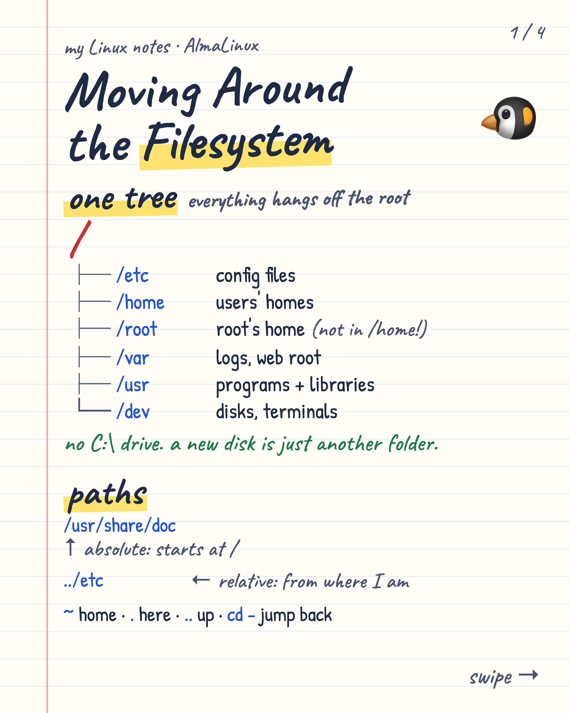
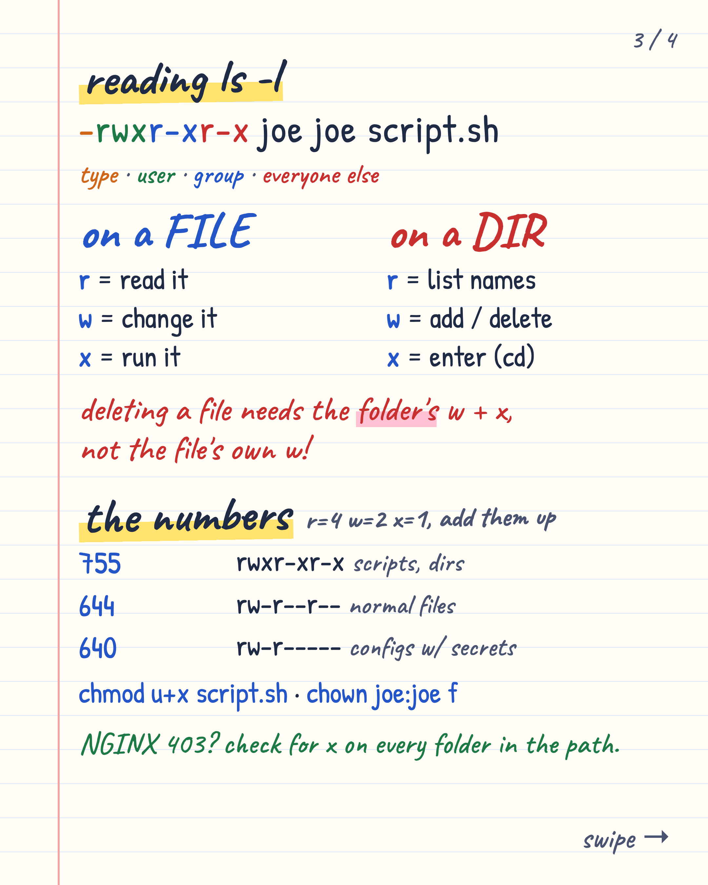
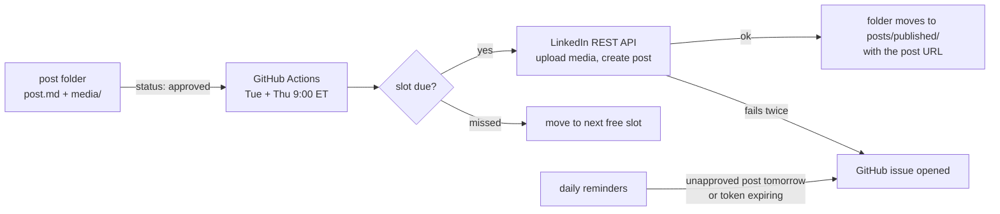

# linkedin-post-pipeline

Write LinkedIn posts as folders in Git, approve them with one line, and let GitHub Actions publish them on schedule
through the official LinkedIn API. Text, single images, carousels (up to 20 images), GIFs and MP4 video.

Nothing posts until a human sets `status: approved`.

<p align="center">
  
  
</p>
<p align="center"><sub>An example carousel from <code>posts/drafts/</code>, rendered from HTML with Playwright.</sub></p>

## How it works



- **Approval gate:** only `status: approved` posts are published. Drafts never leave the repo.
- **Scheduling in Eastern Time:** two cron windows cover both EDT and EST, and the script decides in ET.
- **Missed slots roll forward** to the next free Tue/Thu slot instead of posting at an odd hour.
- **Failures are visible:** one retry, then `status: failed` and a GitHub issue with the API error.
- **Reminders:** an issue the evening before a slot with no approved post, and 7 days before the token expires.
- **Smoke test:** a manual workflow posts and immediately deletes one post of each format.
- **Standard library only** on the Python side. No SDK, no third-party scheduler.

## Repo layout

```
automation/
├── linkedin/
│   ├── authorize.py      OAuth once (and every ~60 days); stores the token as GitHub secrets
│   ├── linkedin_api.py   REST client: images, videos (chunked), multi-image, delete, text escaping
│   ├── posts.py          post folders, front matter, slot logic
│   ├── publish.py        run by the publish workflow
│   ├── reminders.py      run by the reminders workflow
│   ├── smoke_test.py     post-and-delete test of every format
│   └── open_issues.sh    turns script output into GitHub issues (no duplicates)
└── media/
    ├── render.mjs        HTML → PNG (Playwright + Chrome), for carousels and infographics
    ├── record.mjs        animated HTML → GIF or MP4 (deterministic frames + ffmpeg)
    └── gen_image.py      optional: OpenAI image generation from a prompt file
posts/
├── drafts/YYYY-MM-DD-<slug>/   post.md, media/ (what gets posted), source/ (HTML, prompts)
└── published/                  filled in by the workflow
docs/linkedin-app-setup.md      creating the LinkedIn developer app (~15 min)
```

## A post

```markdown
---
publish_at: 2026-10-27 09:00
status: draft
topic: linux
alt: Page 1: the directory tree | Page 2: wildcards and redirection | Page 3: ls -l | Page 4: umask
---

Post text. #hashtags become real hashtags; other reserved characters are escaped for you.
```

- `publish_at` is Eastern Time and should be a Tue or Thu at 09:00 (change `SLOT_DAYS` / `SLOT_HOUR` in `posts.py`).
- `media/` holds one `.mp4`, or 1-20 `.png`/`.jpg`/`.gif` files, posted in file-name order.
- `alt` is the alt text: one description per image, separated by ` | `, in file order. For a video it's the title.

## Setup

1. Create the LinkedIn developer app: [docs/linkedin-app-setup.md](docs/linkedin-app-setup.md).
2. Export `LINKEDIN_CLIENT_ID` and `LINKEDIN_CLIENT_SECRET`, log in with `gh auth login`, then from your clone run:
   ```bash
   python3 automation/linkedin/authorize.py
   ```
   It stores `LINKEDIN_ACCESS_TOKEN` and `LINKEDIN_PERSON_URN` as secrets and `LINKEDIN_TOKEN_EXPIRES_AT` as a
   variable. The scheduled workflows stay idle until that variable exists.
3. Run **LinkedIn smoke test** from the Actions tab.
4. Add a post folder, set `status: approved`, push.

LinkedIn tokens last about 60 days; rerun `authorize.py` when the reminder issue opens. LinkedIn also retires API
versions after about a year: set the repo variable `LINKEDIN_API_VERSION` (`YYYYMM`) if posts start failing with a
version error.

## Rendering media

```bash
npm i playwright            # in any scratch folder; uses your installed Google Chrome
export PLAYWRIGHT_DIR=$PWD/node_modules
node automation/media/render.mjs <post>/source/carousel-handwritten.html <post>/media/01-x.png "#p1" 2
node automation/media/record.mjs <post>/source/animation.html <post>/media/x.gif 10   # needs ffmpeg
```

`record.mjs` expects the page to define `window.FRAMES` and `window.setFrame(i)`, so every frame is drawn the same way
on every run. LinkedIn caps GIFs at 250 frames.

## License

MIT
